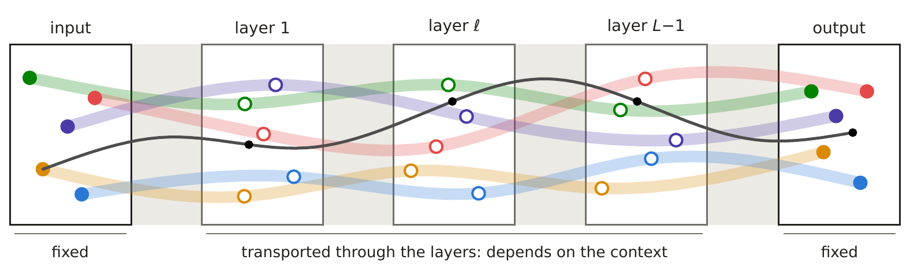
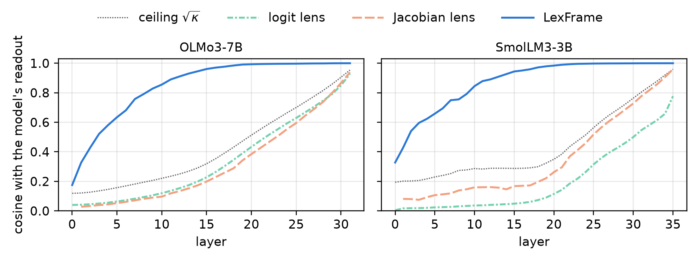
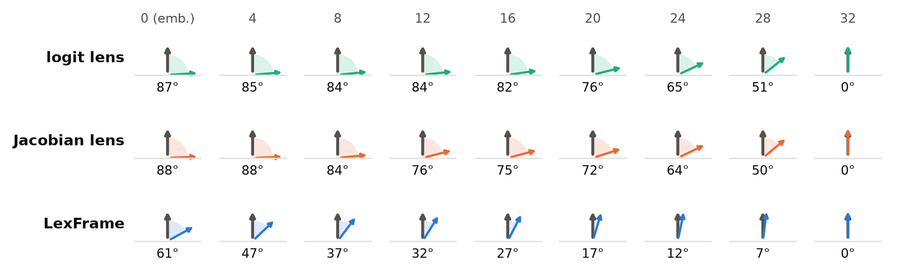

<details class="toc" markdown="1">
<summary accesskey="c" title="(Alt + C)"><span class="title">Table of Contents</span></summary>
<div class="inner" markdown="1">

* TOC
{:toc}

</div>
</details>
<!-- toc -->

Given *"The Space Needle is located in the city of"*, OLMo3-7B predicts *" Seattle"* (probability 0.42). The table traces this choice through the layers: the top token that three methods read at the last position, after every second layer. Model layers are numbered from 1, and layer 0 is the embedding:

| Layer (of 32) | Logit lens | Jacobian lens | LexFrame |
|---|---|---|---|
| 0 | *"ft"* | *".\n"* | *" the"* |
| 2 | *" these"* | *"   \n"* | *" the"* |
| 4 | *" \u200b\u200b"* | *"!\n\n\n\n\n\n"* | *" New"* |
| 6 | *" \u200b\u200b"* | *"...\n\n\n"* | *" New"* |
| 8 | *" \u200b\u200b"* | *" \u200b\u200b"* | *" New"* |
| 10 | *" \u200b\u200b"* | *" city"* | *" \n"* |
| 12 | *" \u200b\u200b"* | *","* | *" \n"* |
| 14 | *" ______"* | *" ___"* | *" \n"* |
| 16 | *" __"* | *" ___"* | *" \n"* |
| 18 | *" __"* | *" ___"* | *" \n"* |
| 20 | *" __"* | *" ___"* | *" Seattle"* |
| 22 | *" __"* | *" Seattle"* | *" Seattle"* |
| 24 | *" Seattle"* | *" Seattle"* | *" Seattle"* |
| 26 | *" Seattle"* | *" Seattle"* | *" Seattle"* |
| 28 | *" Seattle"* | *" Seattle"* | *" Seattle"* |
| 30 | *" Seattle"* | *" Seattle"* | *" Seattle"* |
| 32 | *" Seattle"* | *" Seattle"* | *" Seattle"* |

Both lenses show noise or blanks up to layer 20 and settle on *" Seattle"* only at layers 22 and 24, yet LexFrame reads a city name, *" New"*, at layers 4 to 8 and *" Seattle"* from layer 20 on. How intermediate layers are read matters for attribution and steering. We argue that lenses fall short because they read all states of a layer the same way, and that this rigidity caps how closely they can follow the model.

## Every hidden state has a native frame

Tokens are the smallest units of meaning that a model receives and produces, and its output expresses the final state in these units, with each token's logit as its coefficient. Each token also has a lexical basis: summing the bases with their coefficients reconstructs the state, and projecting the state on a basis returns that token's logit. This output frame thus decomposes and recomposes states without loss, while the embedding fixes the input frame at the other end.

Between these two fixed frames the model defines none, so interpretability has to borrow one. The logit lens, from nostalgebraist's ["interpreting GPT: the logit lens"](https://www.lesswrong.com/posts/AcKRB8wDpdaN6v6ru/interpreting-gpt-the-logit-lens), borrows the output frame, and the [Jacobian lens](https://arxiv.org/abs/2607.15495) fits one linear map per layer. Both read all states of a layer the same way and can fail silently wherever the model reads a state differently.

What decides the meaning of a hidden state at layer 16? We think layers 17 to 32 do: they alone read the state, in its context. We call their reading the state's native reference frame, and we believe it is what mechanistic interpretability has been missing.[^paper]

We define the native frame through the remaining layers. A token's readout is the gradient of its output logit with respect to the state, taken through the model's own layers with the prefix in place, and it points uphill. Its coefficient is the logit that the state carries by itself, and its lexical basis has a part along the state, which recomposes the state from the coefficients, and a part across it, which raises the token's logit by the step. Uphill changes from place to place, so the readout depends on where the state lies. Native frames shift layer by layer for the same reason, from the fixed input frame to the fixed output frame, and they adapt to the context because the readouts carry each state's prefix along.



Native frame with five lexical bases (coloured) and one state (black). It is fixed at the input and output and shifts layer by layer in between.
{: .caption}

## Native frames break the lens ceiling

How close can a fixed lens ever come to the native frame? A lens assigns each token a single bearing for uphill, the same wherever the state stands. For example, the logit lens takes the bearing at the output, accurate there but less so at earlier layers, and a fitted lens at best takes the average bearing. Such a bearing points the wrong way wherever uphill differs from it, and the more these directions spread, the worse even the best bearing does.

Consider one token's unit readouts at many states of a layer, and let κ denote their mean pairwise cosine, a measure of how consistently they point the same way. No fixed direction can exceed √κ on average, and the bound depends only on this spread, so neither more data nor a better fit can raise it. This ceiling is also low. We measured a mid-depth √κ of 0.35 in OLMo3-7B and 0.30 in SmolLM3-3B, and every lens we tested stays below it.

Native frames have no such ceiling, and LexFrame computes them from the model's own remaining layers. It reads a state by itself, as a lens does, by replacing each later attention write with its expected value given the state, fitted on unlabelled text, not on the model's output. Its readouts are the model's own gradients at each state, so the bound on fixed directions does not apply to them. LexFrame therefore exceeds the ceiling at every layer in both models, with a cosine of one, where both lenses stay below 0.3 at mid-depth. The gap narrows only in the last few layers.



Cosine with the model's readout in OLMo3-7B (left) and SmolLM3-3B (right). Every fixed method stays below the √κ ceiling (dotted), whereas LexFrame rises above it.
{: .caption}

Analyses that rely on lens directions, such as attribution and steering, inherit this ceiling, but LexFrame works in the native frame instead. In particular, it steers a state by rotating it so that chosen tokens' logits change by given amounts while the other tokens change least, and it ablates what any layer, sublayer or source position wrote. The native frame is not a ground truth, only the model's own reading of a state, but any other reading can be checked against it.

## Convergence follows least dissipation



Mean angle between each method's reading and the model's output distribution (grey) after every fourth layer of OLMo3-7B. LexFrame closes the angle steadily, whereas the lenses stay far off until the output.
{: .caption}

At which layer does the model actually settle on its answer? We find that LexFrame's mean angle to the model's output distribution shrinks by a steady 1.7 degrees per layer in OLMo3-7B and reaches zero at the last layer, and that it settles on the model's top token earlier than the lenses, as the opening example shows. But lenses tell a different story, with no answer for most of the depth and an abrupt one near the output. These two accounts cannot both be right, and we think the lenses are wrong: their late jump marks where a fixed frame starts to match the model's, not where the model decides.

LexFrame's steady decline in angle resembles a system driven at constant speed, which covers the same distance towards equilibrium at each step. Such a system follows the principle of least dissipation: of all ways to cover that distance in the same number of steps, it takes the one that dissipates the least energy, approaching steadily without overshooting or stalling. A fully trained model may behave the same way.

Training pushes each block to move the state towards the answer from wherever earlier blocks left it. A block that overshoots leaves later blocks to undo its work, and a block that idles wastes its capacity, so long training tends to remove both. Blocks of equal capacity would then close the gap by similar angles, tracing the path of least dissipation. We have tested several models so far, and this account is an argument from training dynamics, not a measured law.

## Explore LexFrame

```bash
pip install lexframe
```

```python
import lexframe as lf

frame = lf.LexFrame(model, tokenizer).init(texts)            # a loaded Hugging Face model and any unlabelled texts
text = "The Eiffel Tower is located in the city of"
s = frame.state(text)                                        # the hidden states of every layer and position
s[:, -1].logits().softmax(-1).topk(5)                        # logits: the top 5 labels that each layer's state carries
moved = s[16, -1].steer({" Paris": -4, " London": 4})        # steer: move layer 16 from Paris toward London
moved[-1, -1].logits().softmax(-1).topk(5)                   # the model's output after the move
s[13, -1].ablate()[-1, -1].logits().softmax(-1).topk(5)      # ablate: the output without layer 12's write at the last position
b = s[16, -1].basis([" Paris", " London"])                  # basis: the labels' semantic bases at a state
```

[^paper]: Paper: [Lexical Reference Frames](https://arxiv.org/abs/2610.22169). Repo: [lexframe](https://github.com/jianguda/lexframe).
